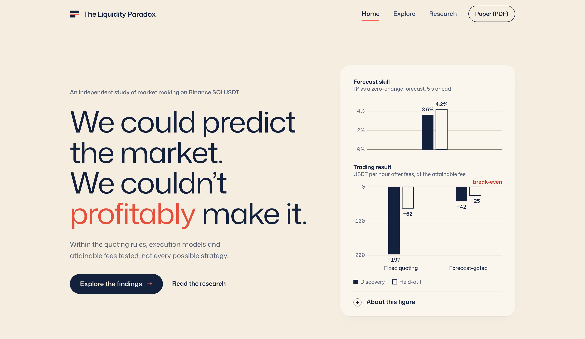

# The Liquidity Paradox

A market maker earns the spread by resting orders at the best bid and ask, and loses whenever the price moves against
an order it has just filled. If short-horizon prices are predictable, a quoter should be able to step aside before those
moves and keep only the good fills. This project tests that idea on Binance spot SOLUSDT, with four pre-registered
experiments and a single evaluation on data kept sealed until the end.

The forecasts worked. Under every quoting rule tested, the market making did not.

## The research question

Does short-horizon price predictability translate into profitable passive market making?

It seems as if it should. A passive quote is filled when someone else chooses to trade against it, and traders who
cross the spread tend to be right about the next move. A quoter that could anticipate those moves would withdraw just
before them. But three things stand between a forecast and a profit:

- **Skill on average is not skill at the moment of a fill.** A forecast is scored across every moment of the day. A
  market maker earns or loses only at the moments it is filled, which are disproportionately the moments the price is
  about to move against it.
- **The edge has to clear the fee.** At the standard Binance fee of 10 basis points per fill, 8 to 17 price ticks at
  the prices studied, a five-second forecast whose average size is about half a basis point cannot pay for itself.
- **Trading less is not trading better.** A rule that withdraws more often also trades less. If every trade loses,
  it loses less in total without being any better per unit traded.

The paradox is that predictability can be real, measurable and persistent while profitable passive quoting remains out
of reach.

## What I investigated

The study rebuilds the SOLUSDT limit order book from Binance's incremental depth stream on twenty first-of-month
sessions, March 2025 to October 2026, and pairs it with the exchange's trade archive. Intervals are kept only while the
rebuilt book is provably correct; anything else is excluded rather than repaired. Four experiments then build the
argument in order:

- **E001, adverse selection, observed.** Using recorded trades alone, with no simulated orders: after each aggressive
  trade, how far did the price keep moving in the aggressor's direction, and what did the passive side keep after
  1, 5 and 30 seconds?
- **E002, execution sensitivity.** A replay engine places hypothetical one-SOL quotes into the historical market.
  Because no one can observe where such an order would have stood in the queue, three queue models and three latency
  brackets (2, 30 and 115 ms) bracket the unknown, under five fee schedules. Could any plausible execution assumption
  change the answer?
- **E003, prediction and quoting.** Two linear forecasts of the five-second price change, one from order-book
  imbalance at the best prices and one from eight book and trade features, fitted walk-forward. Eight quoting rules:
  a no-trade baseline, fixed quoting, forecast-gated, fee-aware and risk-controlled rules, and a placebo that applies
  the same gate with the forecast reversed. Does skill become better fills, and does any rule beat not trading at all?
- **E004, stale information.** The participant's market data were deliberately interrupted, far more often than real
  connections fail. Are the fills it receives while its view is stale worse than fills in random windows of the same
  length, and does withdrawing when stale help?

## Key findings

**Forecasts have real but modest skill** (observed). The eight-feature forecast's out-of-sample R² at five seconds was
3.6% across ten walk-forward discovery sessions and 4.2% on the five sealed sessions. R² is measured against a forecast
of no change: the model's squared prediction error was about 4% lower than that of predicting no change at all. The
skill is real and held on new data, but most of every five-second move remains unpredictable.

**Liquidity at the best prices is adversely selected** (observed). After the average aggressive trade the mid kept
moving in the aggressor's direction, by 1.17 basis points within 30 seconds in discovery. The passive side's 30-second
realized spread was −1.06 bp (95% session-bootstrap interval −1.24 to −0.86) in discovery and −0.59 bp on the sealed
days: about half as large, with the same sign. These are averages over millions of trades, not a claim about every
fill.

**Every simulated quoting rule lost money after fees** (simulated). At VIP0, the 10 bp maker fee that is the only tier
a participant of this size can attain, every rule that traded lost money in every session, about 11 to 12 bp of
everything it traded. Fixed quoting lost 1.5 bp per unit traded before fees and 11.5 bp after, or 197.4 USDT per hour
in discovery and 62.3 on the sealed days. Across the 18 tested execution scenarios (two fixed rules under three queue models and
three latency brackets), results moved by less than a basis point. The fee, not the execution assumptions, decides the outcome.

**Lower losses came from trading less** (simulated). The forecast-gated quoter lost 42.3 USDT per hour against 197.4
for fixed quoting, but it traded 79% less (35,692 against 171,157 USDT of turnover per hour), and per unit traded it was
no better: −11.74 bp against −11.52 bp. On the sealed days it lost 37.5 USDT per hour less, of which 33.2 was simply
the maker fee not paid on trades it did not make. Against the placebo, its fill quality per unit traded showed no
material improvement.

**Stale information did not visibly hurt fills** (stress test). Fills received while the participant's view was stale
showed no material deterioration under the specified threshold of one basis point. That is a narrow result: it is not
a finding of equivalence, and it says nothing about smaller effects.

## The interactive website

The repository includes a companion website that lets readers work through the evidence rather than take it on trust.
Every number on it is labelled as observed, simulated, a stress test or a hypothetical fee.

- **Home** states the paradox in one figure: forecast skill above zero and the trading result below break-even, each
  on its own scale, with the study summarised in four sentences.
- **Explore** opens with a six-step guided story, from a working forecast to a losing market maker. Readers switch the
  fee schedule and watch only the fee change while the fills stay the same, and see how much of a smaller loss comes
  from trading less.
- **The Scenario Lab**, within Explore, covers every tested scenario: any of the eight quoting rules against any
  other, discovery or sealed sessions, each fee schedule, queue model and latency. A "What changed, and why?" panel
  explains each change from the study's own results. Settings the study never tested say so; nothing is interpolated.
- **Research** presents each experiment from its question to its limitations, the full table of held-out results, the
  methods and equations, and a guide to reading the paper.

The site is not hosted. It builds locally from `web/` with Node 24:
`cd web && npm ci && npm run build && npm run preview`.

## Research paper

**[The Liquidity Paradox: Short-horizon predictability, adverse selection and the economics of passive market making](docs/memo/The_Liquidity_Paradox.pdf)**
 Pre-registered evidence from Binance SOLUSDT with a one-time held-out evaluation. Vatsal Maniar, November 2026.

**[Reproducibility supplement](docs/memo/Reproducibility_Supplement.pdf)**: each result mapped to its specification,
output and version identifier, with the checks run before the held-out evaluation.

The pre-registered experiment specifications and the final evaluation protocol are in
[`docs/experiments/`](docs/experiments/).

## Methodology and limitations

**Sample and design.** Twenty first-of-month UTC sessions. Every experiment was specified in advance and decided on
fifteen discovery sessions (March 2025 to May 2026); the forecasting experiments were evaluated walk-forward, each
session using only models fitted on earlier ones. Five later sessions (June to October 2026) stayed sealed until the
evaluation protocol was frozen, and were evaluated once, with models carried forward unchanged.

**The held-out check.** The pre-registered checks held: E001 6 of 6 confirmed, E003 3 of 3 confirmed, E004 2 of 2
confirmed. These are point-estimate checks on five sessions, decided by the sign or size of a mean, in some cases with a
count of sessions. They show that a
discovery result did not reverse; they are not tests of significance or independent replications. Trading results on
the sealed days are reported descriptively, with no confirmation claim.

**Simulation.** Trading results are replays of the historical market in which the simulated orders never existed:
fills are inferred under stated queue, latency and fee assumptions, and the orders have no market impact. Queue
position cannot be observed, so the three queue models bracket it without being proven bounds.

**Limitations.** Five sessions give little statistical power, and first-of-month days may not represent other days. The
study covers one instrument on one venue. The forecasts are linear and the quoting rules are fixed in advance, not
optimised strategies. Only the standard fee is attainable, so results under rebate tiers are hypothetical, and E004's
interruptions are synthetic. The findings concern the rules tested, not every possible strategy.

## Data sources and attribution

- **Order-book data:** [Tardis.dev](https://tardis.dev) free first-of-month samples of Binance's incremental depth
  stream, used under the Tardis.dev Terms of Service.
- **Trades:** [Binance Vision](https://data.binance.vision), Binance's public trade archive, licensed under
  [CC BY-NC-SA 4.0](https://creativecommons.org/licenses/by-nc-sa/4.0/).

The raw market data are not redistributed. The statistics, tables and figures derived from them are licensed under
CC BY-NC-SA 4.0 with attribution to Binance Vision, as its terms require; no licence is granted for the source code or
the text of the paper. This is independent, non-commercial academic research, not affiliated with or endorsed by
Binance or Tardis.dev. [`DATA_NOTICE.md`](DATA_NOTICE.md) gives the exact scope, the required credit and the source
terms.

**Reproducibility.** `shasum -a 256 -c docs/memo/FROZEN.sha256` verifies the paper and its sources, and
`uv run pytest @pytest-public.args` runs the test suite. That command sets aside the integrity tests of the held-out
procedure, which compare files against the private research archive. The archive keeps the full development history
cited in the frozen records, together with the fine-grained data-acceptance listings and the fitted model parameters,
which are not redistributed here.
